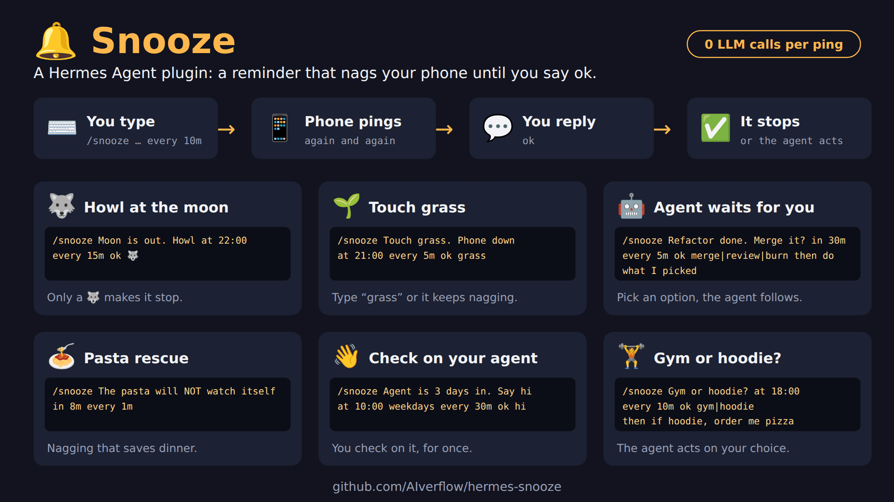

# hermes-snooze

hermes-snooze is a plugin for [Hermes Agent](https://github.com/NousResearch/hermes-agent). It repeats an LLM-free reminder in your chat until you answer it or a configured limit is reached.

Add a follow-up and your agent acts after you answer. Add choices and it acts on the option you pick. The command is `/snooze`.

## Before you start

hermes-snooze sends its reminders through a messaging platform, so **Hermes needs at least one platform configured** (for example Telegram or Discord). Without one there is no chat to remind you in. Requires Hermes Agent 0.22.7 or later and Python 3.10+.

| Platform | Status |
|---|---|
| Telegram | ✅ Tested (private chat) |
| Discord | 🔧 In progress |
| Other Hermes platforms (Slack, Signal, …) | ❔ Untested, may work |

WhatsApp Cloud API is not supported.

## Install

```bash
hermes plugins install AIverflow/hermes-snooze
hermes plugins enable snooze
hermes gateway restart
```

Or clone this repository into `~/.hermes/plugins/snooze`, enable the plugin, and restart the gateway.

## Start

In a Telegram private chat or Discord chat already connected to Hermes, check delivery first:

```text
/snooze test
```

Reply `Ok` to the test reminder. Once the test passes, try your first snooze:

```text
/snooze Drink a glass of water in 1m every 1m
```

About a minute later you receive a message like this, and a new one every minute until you answer:

```text
🔔 Snooze #12: Drink a glass of water  (reply "Ok" | later)
```

Reply `Ok` when done: Snooze answers `✅ Done: Drink a glass of water` and stops. Reply `later 15` to postpone by 15 minutes. To cancel instead, use `/snooze cancel 12` with the ID in your reminder.

You can also ask Hermes in plain language: "Remind me to update Hermes in 1 hour, then every 10 minutes until I confirm."

For [setup](docs/user-guide.md#setup-and-configuration), [commands](docs/user-guide.md#commands), [confirmations](docs/user-guide.md#confirmations), [recurrence](docs/user-guide.md#create-a-snooze), and [script use](docs/user-guide.md#create-from-scripts), see the user guide.

## What you can do

Every example repeats its reminder every 5 to 30 minutes until you answer (`Ok`, or the word or choice the command asks for), or until a limit is reached.

### 1. Simple

```text
/snooze Polish Zeus's thunderbolts in 20m every 10m
→ reply: Ok | later
/snooze Take a break, stand up in 50m every 5m ok done
→ reply: done | later
/snooze Cancel the streaming trial before it bills at 10:00 every 30m ok cancelled
→ reply: cancelled | later
```

### 2. With a follow-up action (`then`)

Reply `Ok`: the agent gets the `then` text and does it, with the tools you gave it: write files, send email, edit Google Docs, run scripts, run skills…

```text
/snooze Stop the rented GPU at 19:00 every 10m then shut down the instance and tell me what it cost
→ reply: Ok | later
/snooze Check last night's backup at 08:30 weekdays every 15m then run ./verify-backup.sh and show me the result
→ reply: Ok | later
```

### 3. With choices (`ok a|b|c`)

Each reminder lists the options. Reply with an option or its number: the agent gets your choice.

```text
/snooze Refactor done. Merge? in 30m every 10m ok merge|review then do what I picked
→ reply: merge | review | later   (or 1 | 2)
/snooze Ship to production? at 17:30 every 10m ok ship|hold then if I chose ship, run ./deploy.sh prod and announce it with my release-notes skill
→ reply: ship | hold | later   (or 1 | 2)
```

For every clause and rule, see the [user guide](docs/user-guide.md#create-a-snooze).

## Keywords

Type these after `/snooze <what>`, in any order; put `then` last. Details: [user guide](docs/user-guide.md#create-a-snooze).

| Keyword | What it does | Example |
|---|---|---|
| `at <time>` | First reminder at a time of day | `at 16:00` |
| `in <duration>` | First reminder after a delay | `in 30m` |
| `every <duration>` | Time between reminders (default 10m) | `every 5m` |
| `daily` (or `everyday`) / `weekdays` / `every <days>` | Repeat every day, Monday to Friday, or on listed days (`monday-friday` is a range; `mon` works too) | `at 8am daily`, `at 8am weekdays`, `at 8am every monday,thursday` |
| `on <day>` | One time, on the next such day | `at 9am on monday` |
| `until <time>` | Stop reminding at this time | `until 18:00` |
| `via <platform>` | Send to that platform's home channel (`telegram` or `discord`) | `via discord` |
| `ok <answer>` | Confirm with a word, an emoji, or choices (`a\|b\|c`); the guide lists the rest | `ok done`, `ok ✅`, `ok merge\|review` |
| `then <action>` | The agent does this after you confirm | `then run ./deploy.sh` |
| `later [N]` | Reply in the chat to postpone N minutes (default: the `every` interval) | `later 15` |

## Limits

- The Hermes gateway must be running on an awake machine for reminders and replies to work.
- Snooze does not support voice-note confirmations or WhatsApp Cloud API.
- Reaction confirmations are supported only in Telegram private chats.
- Snoozes belong to the Hermes profile: `/snooze list`, `/snooze ok` and `/snooze cancel` act on every snooze of the profile, whatever chat it was sent to, and anyone Hermes authorizes in that profile can use them. Replies in the chat only count in the reminder's own chat.


